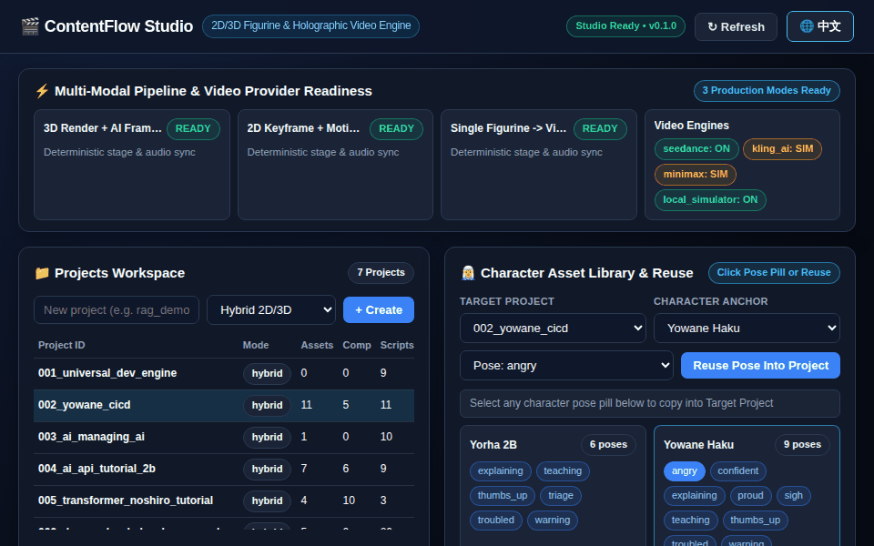

# ContentFlow: 通用多模态内容与视频生产工作区

**ContentFlow** 是一个通用、解耦的自动化全媒体内容与短视频生产工作台。它不绑定任何单一产品或系统，任何软件、开源项目、技术主题或知识概念均可通过定义结构化素材（FactSheet），一键自动生产全渠道图文与高清配音字幕短视频。

<p align="center">
  
</p>

---

## 核心架构与设计理念

```
ContentFlow/
├── config/                  # 渠道规范、音色预设、字体与全局配置
│   ├── settings.py          # 路径管理与 MoneyPrinterTurbo 集成配置
│   └── channel_specs.json   # 微信/小红书/知乎/V2EX/发布通知渠道规格
├── core/                    # 核心流水线与引擎适配层
│   ├── models.py            # FactSheet、Storyboard 与 ContentPackage 数据模型
│   ├── copywriting.py       # 通用全渠道文案生成引擎
│   ├── html_formatter.py    # 微信公众号专属内联 CSS HTML 转换器
│   ├── asset_builder.py     # 视觉幻灯片绘制与 FFmpeg 秒级视频预转引擎
│   └── video_engine.py      # MoneyPrinterTurbo 无头 CLI 调度与产物管理
├── projects/                # 通用项目/主题工作区
│   └── universal_dev_engine/# 示例工程（DevPulse 效能引擎）
│       ├── brief.json       # 结构化事实档案（痛点、解法、特性、技术栈）
│       └── assets/          # 用户自定义图片/视频素材（若为空则自动生成幻灯片）
├── output/                  # 生成产物目录（按项目与渠道归档）
│   └── <project_id>/
│       ├── copy/            # 全渠道文案、内联 HTML、分镜脚本
│       └── video/           # 成片 MP4、SRT 字幕、MP3 配音、封面 JPG
├── vendor/                  # 第三方开源引擎复用
│   └── MoneyPrinterTurbo/   # 复用 upstream 视频合成底座
├── cli.py                   # ContentFlow 统一命令行入口
└── README.md
```

### 1. 为什么复用并深度封装 MoneyPrinterTurbo？
- **避免重复造轮子**：视频合成涉及复杂的字体排版、动态换行、Whisper/Edge 时间戳对齐、音频混音防爆音、多分辨率适配等底层细节。`MoneyPrinterTurbo` 拥有成熟稳定的视频流水线与丰富的免版权商用 BGM/字体库。
- **免 API Key 本地闭环**：通过 ContentFlow 直接向 MoneyPrinterTurbo CLI 注入高质量分镜文案（`--video-script`）与本地素材（`--video-source local`），完全跳过外部收费大模型 API，实现 100% 免费、离线/本地可用。
- **高性能加速层（50x 提速）**：针对 MoneyPrinterTurbo 在 CPU 上使用 MoviePy `resized(lambda t: ...)` 逐帧软件缩放静态图片导致的长达 45 秒耗时问题，ContentFlow 内置了 `AssetBuilder.convert_image_to_mp4_fast()`，在调用上游前先以原生 FFmpeg 完成秒级硬件级封装，大幅压缩成片耗时。

---

## 核心能力矩阵

| 模块 | 输出产物 | 核心特性 |
| :--- | :--- | :--- |
| **微信公众号深度长文** | `wechat.md` & `wechat.html` | 1500~2500字深度叙事、痛点根因分析、免外部样式排版的全内联 CSS HTML，直接粘贴即发布 |
| **小红书爆款图文卡片** | `xiaohongshu.md` | 3套高点击率钩子标题、视觉封面与卡片排版指导、Emoji结构化排版、痛点清单与互动引导 |
| **知乎专业深度问答** | `zhihu.md` | 1200~2000字客观评测、第一性原理拆解、架构特性矩阵对比、落地适用边界分析 |
| **开发者社区分享帖** | `v2ex.md` | 真实极客第一人称口吻、不做虚浮宣传、技术选型探讨、求试用与诚恳求反馈 |
| **版本发布通知** | `release.md` | 亮点 Banner、核心功能发布清单、技术基石、快速上手指南 |
| **高清短视频成片** | `final.mp4` / `subtitle.srt` | 1080P 高清画质、Edge-TTS 真实自然人声配音、高精字幕对齐、动态镜头与智能 BGM 混音 |

---

## 快速上手与 CLI 命令

所有命令均可通过项目根目录下的 `cli.py` 驱动：

```bash
# 进入工作区
cd ContentFlow

# 使用 vendor 内部环境执行
VENV_PY=vendor/MoneyPrinterTurbo/.venv/bin/python
```

### 1. 初始化一个新项目
```bash
$VENV_PY cli.py init-project my_product
```
将在 `projects/my_product/` 创建模板 `brief.json` 和 `assets/` 目录。

### 2. 仅生成全渠道文案
```bash
$VENV_PY cli.py generate-copy --project my_product
```
在 `output/my_product/copy/` 自动生成全套微信 MD/HTML、小红书、知乎、V2EX、发布通知与分镜脚本 `storyboard.json`。

### 3. 渲染高清视频
```bash
# 默认 16:9 横屏（B站/YouTube/技术演播）
$VENV_PY cli.py generate-video --project my_product --aspect 16:9 --voice zh-CN-YunxiNeural

# 或 9:16 竖屏（抖音/小红书视频/微信视频号）
$VENV_PY cli.py generate-video --project my_product --aspect 9:16 --voice zh-CN-XiaoxiaoNeural
```

### 4. 一键全流程（文案 + 视频）
```bash
$VENV_PY cli.py run-all --project my_product
```

---

## 自定义扩展

1. **自定义素材**：将产品的实际截图、系统架构图或实录短视频放入 `projects/<project_id>/assets/`，ContentFlow 会优先按顺序采用真实素材进行混剪与配音字幕对齐；若无素材，系统自动调用 `AssetBuilder` 绘制高质感暗黑极客幻灯片。
2. **多语言支持**：支持注入英语、日语等音色（如 `en-US-JennyNeural`），自动生成国际化宣发素材。
