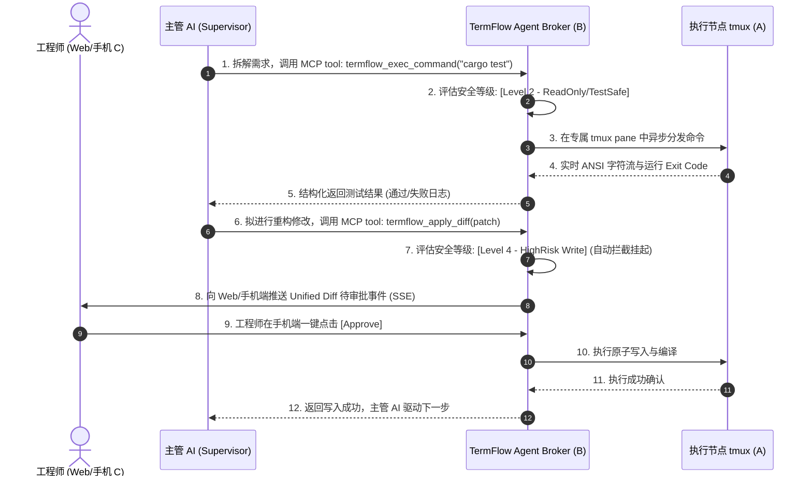

# 《关于 AI 管理 AI 工作的深度调研与实践架构白皮书》
> **副标题**：从“认知编排”到“物理控制舱”：多智能体分层协同的真实落地困境与 TermFlow 架构解析  
> **作者**：TermFlow 核心架构与生态研究组  
> **发布日期**：2026年9月  
> **适用渠道**：技术决策白皮书 / 架构师内参 / 开源生态指引  

---

## 目录
- [一、 执行摘要与调研背景](#一-执行摘要与调研背景)
- [二、 多智能体演进路径：从“单体玩具”到“AI 管理 AI”](#二-多智能体演进路径从单体玩具到-ai-管理-ai)
  - [2.1 第一代：单体 ReAct 循环的认知瓶颈](#21-第一代单体-react-循环的认知瓶颈)
  - [2.2 第二代：扁平智能体群聊的“水群”困局](#22-第二代扁平智能体群聊的水群困局)
  - [2.3 第三代：分层管理与监督（Hierarchical Supervisor-Worker）](#23-第三代分层管理与监督hierarchical-supervisor-worker)
- [三、 理想很丰满，现实很骨感：AI 管理 AI 的“四大物理死穴”](#三-理想很丰满现实很骨感ai-管理-ai-的四大物理死穴)
  - [3.1 死穴一：执行黑盒与断网雪崩（The Ephemeral Runtime Trap）](#31-死穴一执行黑盒与断网雪崩the-ephemeral-runtime-trap)
  - [3.2 死穴二：失控爆炸半径与安全失守（The Blast Radius Crisis）](#32-死穴二失控爆炸半径与安全失守the-blast-radius-crisis)
  - [3.3 死穴三：异构孤岛与内网穿透壁垒（NAT & Ingress Barrier）](#33-死穴三异构孤岛与内网穿透壁垒nat--ingress-barrier)
  - [3.4 死穴四：人机在环（HITL）严重脱节与介入黑洞](#34-死穴四人机在环hitl严重脱节与介入黑洞)
- [四、 破局解法：执行控制舱（Execution Cockpit）范式重构](#四-破局解法执行控制舱execution-cockpit范式重构)
  - [4.1 认知编排层（Cognitive Layer） vs 物理中继层（Execution Broker Layer）](#41-认知编排层cognitive-layer-vs-物理中继层execution-broker-layer)
- [五、 TermFlow 深度解析：为“AI 管理 AI”量身定制的操作系统中枢](#五-termflow-深度解析为ai-管理-ai量身定制的操作系统中枢)
  - [5.1 架构拓扑：主动反向穿透与零公网暴露安全网关](#51-架构拓扑主动反向穿透与零公网暴露安全网关)
  - [5.2 tmux 原生虚拟化：永不断线的进程状态机](#52-tmux-原生虚拟化永不断线的进程状态机)
  - [5.3 内建 Agent Broker 与标准 MCP 原生网关](#53-内建-agent-broker-与标准-mcp-原生网关)
  - [5.4 Level 4 指令审批护栏与结构化 Unified Diff 审查](#54-level-4-指令审批护栏与结构化-unified-diff-审查)
  - [5.5 终极人机共管：跨平台与移动端 18 键触觉接管舱](#55-终极人机共管跨平台与移动端-18-键触觉接管舱)
- [六、 行业主流方案横向多维对比基准（Benchmark Matrix）](#六-行业主流方案横向多维对比基准benchmark-matrix)
- [七、 落地实战蓝图：搭建“主管 AI + 工人 AI + TermFlow”的无人值守研发阵列](#七-落地实战蓝图搭建主管-ai--工人-ai--termflow的无人值守研发阵列)
  - [7.1 架构拓扑部署图](#71-架构拓扑部署图)
  - [7.2 标准 Docker Compose 参考配置](#72-标准-docker-compose-参考配置)
  - [7.3 MCP 工具调用与人机审批流全链路时序](#73-mcp-工具调用与人机审批流全链路时序)
- [八、 总结与项目演进展望：如何把这个项目做大做爆？](#八-总结与项目演进展望如何把这个项目做大做爆)

---

## 一、 执行摘要与调研背景

随着大语言模型（LLM）推理能力的代际飞跃（以 DeepSeek-R1、Claude 3.7 Sonnet、o1 为代表），大模型应用正迅速从“单次问答”转向“长链路自主智能体（Autonomous Agents）”。其中，**“AI 管理 AI 工作（AI Managing AI's Work）”**，即通过高阶认知模型担任架构师/主管（Supervisor/Manager），分解任务、编排下发，并由专属职能模型（Coder/Tester/DevOps Agent）执行落地，已成为学术界与工业界公认的下一代软件工程与企业自动化演进方向。

然而，本调研深入剖析后发现：**当今 90% 的多智能体框架仍停留在“文本聊天室（ChatRoom）”的玩具阶段。**
一旦进入真实的 Linux 生产环境、千万行级工程代码库或长期运维场景，“主管 AI 管工人 AI”就遭遇了极其残酷的物理执行断层：
- **子任务执行进程随 HTTP 断链瞬间暴毙；**
- **下级 Agent 幻觉执行 `rm -rf` 摧毁根文件系统；**
- **生产服务器深居内网 NAT 无法对接到云端 AI；**
- **主管 AI 陷入僵局时人类无法无缝切入实时终端介入。**

针对上述致命痛点，开源项目 [TermFlow](https://github.com/mcocdaa/TermFlow) 创新性地给出了完整的基建级解法。TermFlow 不仅是一个现代化的跨端终端平台，更首创了 **内置 Agent Broker 与标准 MCP 协议人机协同审批流**。它充当了“AI 管理 AI”的**物理操作系统执行层与安全控制舱**，填补了当今多智能体生态中最缺失的一块物理拼图。

---

## 二、 多智能体演进路径：从“单体玩具”到“AI 管理 AI”

```
[第 1 代: 单体 ReAct 循环] ──(上下文爆炸/死循环)──> [第 2 代: 扁平群聊协作] ──(水群刷屏/无执行力)──> [第 3 代: 分层管理与监督 (AI 管 AI)]
```

### 2.1 第一代：单体 ReAct 循环的认知瓶颈
在 2023-2024 年初，以 AutoGPT、BabyAGI 和经典 LangChain ReAct 为代表，单一智能体负责“思考（Thought）- 动作（Action）- 观察（Observation）”。
- **致命瓶颈**：随着任务步数增加，上下文窗口急剧污染，模型逐渐“遗忘初始目标”，并在同几个报错命令间陷入死循环。

### 2.2 第二代：扁平智能体群聊的“水群”困局
随后出现的 AutoGen、CrewAI、ChatDev 等框架引入了多角色协作：定义 Product Manager、Coder、Reviewer 并在一个公用上下文中轮流发言。
- **致命瓶颈**：角色之间没有严格的职权隔离与执行边界，Token 消耗呈立方级爆炸，经常发生“PM 催促 Coder，Coder 反问 PM，Reviewer 礼貌客套”的无效水群刷屏现象，缺乏对真实底层 OS 的强制控制力。

### 2.3 第三代：分层管理与监督（Hierarchical Supervisor-Worker）
2025-2026 年的主流演进范式彻底收敛为 **分层管理与监督模式**：
- **主管智能体（Supervisor / Orchestrator Agent）**：高智力模型（如 DeepSeek-R1、Claude 3.7 Thinking），负责需求拆解、制定 DAG 工作流、派发任务到特定子 Agent、审计阶段产物并仲裁。
- **执行智能体（Worker / Domain Agent）**：聚焦垂直任务的专用模型（如代码生成、单元测试生成、SQL 分析），通过工具调用直接操作环境。
- **评测/裁判智能体（Judge / Verification Agent）**：只负责验证结果是否符合规范，提供无偏见的反思信号（Reflection）。

---

## 三、 理想很丰满，现实很骨感：AI 管理 AI 的“四大物理死穴”

在论文和 Demo 中，Supervisor 调度 Worker 看似完美无暇；但一旦把这项技术引入生产环境（Bare-metal / Docker / Cloud VM），现实会迎头痛击：

### 3.1 死穴一：执行黑盒与断网雪崩（The Ephemeral Runtime Trap）
- **现象**：主管 AI 命令工人 AI 执行内核构建、大数据微调、前端全量编译或复杂测试（通常需要 10~60 分钟）。
- **死穴**：传统框架使用基于 HTTP 的短期子进程调用（如 `subprocess.run` 或 `docker exec` REST API）。一旦 LLM API 超时、网络瞬断或反向代理网关发生 504 抖动，**底层的终端连接立即断开，操作系统触发 SIGHUP 信号将正在运行的编译进程全部杀死**。前功尽弃，甚至造成脏写与包管理器死锁。

### 3.2 死穴二：失控爆炸半径与安全失守（The Blast Radius Crisis）
- **现象**：下级工人 AI 遭遇依赖报错或权限不足时，模型本能地倾向于“暴力脱困”。
- **死穴**：AI 会自动执行 `chmod -R 777 /`、`rm -rf *`、`kill -9`，甚至将包含真实数据库连接串的 `.env` 文件错误上传或在日志中打印泄漏。
- **问题根源**：缺乏**指令级安全语义解析器与细粒度审批防护网**。

### 3.3 死穴三：异构孤岛与内网穿透壁垒（NAT & Ingress Barrier）
- **现象**：主管 AI 往往部署在公有云大算力平台，而实际的编译机、测试机、边缘 GPU 工作站或机房服务器深居企业企业防火墙与内网 NAT 之后。
- **死穴**：如果要求每一台 Worker 机器对外开放 SSH 端口（22）并配置公网 IP，将直接违反企业网络安全合规规范，带来毁灭级的公网渗透风险。

### 3.4 死穴四：人机在环（HITL）严重脱节与介入黑洞
- **现象**：当主管 AI 与工人 AI 在关键决策上产生分歧（例如架构重构引发的重大迁移）、或者遭遇无法自动化解决的交互式凭证输入（如 TOTP、硬件密钥确认、图形化交互）时，系统彻底停摆。
- **死穴**：大部分 Multi-Agent 系统只提供一个网页文本框或命令行日志流。人类工程师根本无法**实时切入当前的 TTY/Terminal 交互现场**。工程师不得不重新手动 SSH 登入机器排查，导致 Agent 上下文与人类现场完全割裂。

---

## 四、 破局解法：执行控制舱（Execution Cockpit）范式重构

要让“AI 管理 AI”真正走出玩具泥潭，工业界必须建立全新的认知分层：

```
┌─────────────────────────────────────────────────────────────┐
│                 认知与决策层 (Cognitive Layer)              │
│   Supervisor Agent ◄───(Task/Spec)───► Worker Agent (LLM)   │
│   [高阶规划、DAG拆解、反思仲裁、结果归纳]                    │
└──────────────────────────────┬──────────────────────────────┘
                               │ MCP (Model Context Protocol)
┌──────────────────────────────▼──────────────────────────────┐
│            物理执行与安全控制舱 (Execution Cockpit Layer)    │
│                     【 TermFlow 】                          │
│  - 状态持久化 (tmux Virtualization & Session Recovery)       │
│  - 主动反向穿透 (Outbound WSS / Zero Ingress Exposure)       │
│  - Agent Broker 安全中介 (Permission Guard & Level 4 Approval)│
│  - 人机实时共管 (Human-in-the-Loop Web/Mobile Cockpit)       │
└──────────────────────────────┬──────────────────────────────┘
                               │ PTY / POSIX System Calls
┌──────────────────────────────▼──────────────────────────────┐
│                  物理计算节点 (Computer A)                  │
│       Linux Bare-metal / Docker Node / Edge Workstation     │
└─────────────────────────────────────────────────────────────┘
```

**核心论点**：
> **“大模型负责脑力，控制舱负责躯体。”**
> 没有可靠、持久、安全、具备人机在环能力的物理执行控制舱，任何多智能体管理系统都只是建在沙滩上的空中楼阁。

---

## 五、 TermFlow 深度解析：为“AI 管理 AI”量身定制的操作系统中枢

[TermFlow](https://github.com/mcocdaa/TermFlow) 并非一个简单的 WebSSH 工具，而是一套完整的**跨平台终端与智能体中继平台（Resilient Terminal & Agent Broker Platform）**。在“AI 管理 AI”的拓扑中，TermFlow 扮演了不可替代的中枢角色：

### 5.1 架构拓扑：主动反向穿透与零公网暴露安全网关
TermFlow 采用革命性的三层解耦架构：
1. **Computer A（计算执行节点 / Worker Host）**：
   - 运行受管工程代码与真实 tmux 终端。
   - **不开放任何入站端口（Zero Ingress Port）**，而是通过加密 WSS/WebSocket **主动向控制面 B 建立长连接**。
   - 彻底解决 NAT 穿透与安全合规问题，内网边缘机与私有算力节点即插即用。
2. **Control Plane B（控制面 + Agent Broker）**：
   - 采用 FastAPI 异步核心，提供严格的双因子身份认证、节点注册令牌分发、状态心跳同步与流量中继。
   - 自身可安全部署在公有云容器编排环境。
3. **Web C / Native Client C（人机协同前端控制舱）**：
   - 基于 Vue 3 + TypeScript + Vite + xterm.js，同时支持 Tauri 2 跨平台原生桌面端与移动端浏览器。

### 5.2 tmux 原生虚拟化：永不断线的进程状态机
TermFlow 底层深度接管操作系统级 `tmux` 会话状态机：
- **生命周期彻底解耦**：终端命令的生命周期与客户端/API连接彻底分离。即使 AI 发生网络超时、甚至主管 AI 容器重启，底层的长期构建/训练进程依然安然运行。
- **即时恢复（Seamless Re-attach）**：AI 或人类工程师随时通过 `attach` 无缝重连会话，完整查看 ANSI 彩色历史缓冲区与当前运行状态。

### 5.3 内建 Agent Broker 与标准 MCP 原生网关
在 v0.2.0 中，TermFlow 正式推出了 **Agent Broker**：
- **中立安全代理**：向下游大模型运行时（如 OpenCode、Claude Code、DeepSeek 引擎）暴露标准 **MCP（Model Context Protocol）** 协议接口。
- **强制白名单策略**：在 `opencode-config.yaml` 中固化执行策略：
  ```yaml
  permission:
    "*": "deny"
    "termflow_*": "allow"
  ```
  模型自带的危险未审计底层工具被完全封禁，模型操作必须严格通过 TermFlow 受控 MCP 工具集（终端观察、状态探针、安全写入与审批）发起。

### 5.4 Level 4 指令审批护栏与结构化 Unified Diff 审查
在传统多智能体中，Agent 的写入操作是“闭眼狂奔”的；而在 TermFlow 的管辖下：
- **语义级安全分级**：只读探索命令（如 `ls`、`cat`、`git status`、`grep`）自动放行；高危写操作、破坏性清理（如 `rm`、`dd`、`chmod`、代码大范围覆写）直接触发 **Level 4 审批网关**。
- **结构化 Unified Diff 审查面板**：当 Worker Agent 提议修改代码时，系统自动提取结构化 Diff 差异，以高对比度高亮形式呈现给主管 AI 或人类工程师，支持一键审批或一票否决。

### 5.5 终极人机共管：跨平台与移动端 18 键触觉接管舱
当主管 AI 与工人 AI 发生僵持或需要外部物理确认时，人类无需手忙脚乱找电脑：
- **移动端专属按键坞（MobileKeyBar）**：专门为移动触摸屏定制 18 颗极客按键（`Esc`, `Ctrl`, `Alt`, `Tab`, `|`, `~`, 方向键），具备原生振动触觉反馈。
- **随时随地兜底**：工程师在地铁上、床上用手机打开浏览器即可直接进入报错的 tmux 终端窗口，修复环境后一键继续交由主管 AI 接管。

---

## 六、 行业主流方案横向多维对比基准（Benchmark Matrix）

为了更直观展示 TermFlow 在“AI 管理 AI”执行层中的代际领先优势，我们梳理了多维对比矩阵：

| 评估维度 | 裸写 Docker Exec / SSH | 纯聊天框架 (AutoGen / CrewAI) | 商业级单体 (Devin / OpenHands) | **TermFlow 智能体控制舱** |
| :--- | :--- | :--- | :--- | :--- |
| **持久执行保障** | ❌ 进程随连接断开而终止 | ❌ 纯依赖 HTTP 接口，极易中断 | ⚠️ 依赖远端沙盒，成本极高 | **✅ 原生 tmux 虚拟化，永不掉线** |
| **内网穿透能力** | ❌ 必须开放 22/Docker 端口 | ❌ 依赖直连，无法穿透内网 | ⚠️ 必须把数据全部上传至公有云 | **✅ 主动反向安全长连接，零端口暴露** |
| **AI 接口标准化** | ❌ 无，需自行编写脚本封装 | ⚠️ 内部专有消息协议 | ⚠️ 专有私有协议 | **✅ 原生开放标准 MCP (Model Context Protocol)** |
| **高危拦截与审批** | ❌ 无，一旦放权直接裸奔 | ❌ 仅有粗粒度交互确认 | ⚠️ 黑盒规则，缺乏定制深度 | **✅ Level 4 细粒度审批 + 结构化 Diff 审查** |
| **人机共管体验** | ❌ 人类无法无缝介入现场 | ❌ 只能在文本框打字，无终端感 | ⚠️ 纯网页端，移动设备难以操作 | **✅ 桌面/移动全端覆盖，专属 18 键按键坞** |
| **部署与隐私** | ⚠️ 极度简陋，无审计溯源 | ❌ 依赖大量云端服务 | ❌ 核心闭源或强绑定 SaaS | **✅ 100% 容器化本地私有部署，安全合规** |

---

## 七、 落地实战蓝图：搭建“主管 AI + 工人 AI + TermFlow”的无人值守研发阵列

### 7.1 架构拓扑部署图

```
┌─────────────────────────────────────────────────────────────┐
│                    用户 / 运维主管 (Human)                  │
│       手机端 / 桌面 Web C / 原生客户端 (查看实时事件与审批)    │
└──────────────────────────────┬──────────────────────────────┘
                               │ HTTPS / WSS
┌──────────────────────────────▼──────────────────────────────┐
│         Control Plane B (FastAPI + Agent Broker)            │
│  - Session Router     - Level 4 Approval Gate               │
│  - SSE Event Stream   - MCP Protocol Gateway                │
└──────────────┬───────────────────────────────┬──────────────┘
               │ WSS (主动反向穿透连接)           │ MCP over SSE
┌──────────────▼──────────────┐ ┌──────────────▼──────────────┐
│  Computer A (Node 执行机)   │ │   AI Supervisor & Worker    │
│  - tmux sessions            │ │   (OpenCode / Claude Code)  │
│  - Work dir (/work)         │ │   - 思考规划与任务下发       │
│  - Native Shell (bash/sh)   │ │   - 代码与命令生成           │
└─────────────────────────────┘ └─────────────────────────────┘
```

### 7.2 标准 Docker Compose 参考配置
生产环境只需拉取 TermFlow 官方发布镜像（`compose.release.yaml`），即可一键起动整套安全控制舱：

```bash
# 1. 下载一键生产部署定义
TAG=v0.2.0
BASE="https://raw.githubusercontent.com/mcocdaa/TermFlow/${TAG}"
mkdir -p termflow && cd termflow
curl -fsSLO "${BASE}/deploy/compose.release.yaml"
curl -fsSLO "${BASE}/deploy/opencode-config.yaml"
curl -fsSLo .env "${BASE}/.env.example"

# 2. 启动 Control Plane 与 Agent Broker 服务
docker compose --env-file .env -f compose.release.yaml up -d

# 3. 校验健康状态
curl -fsS http://127.0.0.1:8765/healthz
```

### 7.3 MCP 工具调用与人机审批流全链路时序



---

## 八、 总结与项目演进展望：如何把这个项目做大做爆？

### 8.1 调研结论
“AI 管理 AI”不仅是 Prompt Engineering 或 Multi-Agent 对话流的胜利，更是底层系统软件与执行环境的深层次重塑。**脱离了稳固的物理终端执行舱，任何高阶智能体架构都会在现实世界的复杂网络、长耗时任务与不可控漏洞面前溃不成军。**

[TermFlow](https://github.com/mcocdaa/TermFlow) 精准切中了 AI 从“生成文字”到“接管生产”的最核心咽喉要道。它用极度克制、工业级可靠的工程架构（tmux 原生长保活 + 主动反向安全穿透 + MCP Agent Broker + 移动端自适应按键坞），为全球开发者构筑了一座坚不可摧的“智能体物理控制舱”。

### 8.2 如何把 TermFlow 项目做大做爆？（增长与演进展望）

为了将 TermFlow 推向开源顶流与工业界事实标准，我们建议从以下三大战略维度发力：

1. **生态位对齐（Positioning）**：
   - 坚决不做泛化的聊天应用，牢牢锚定 **“The Execution Cockpit for AI Agents（面向智能体的操作系统级执行控制舱）”**。
   - 紧密拥抱 **Anthropic 推出的 Model Context Protocol (MCP)** 标准，成为 GitHub 上最成熟、体验最佳的“MCP-Native 终端与沙盒中继标杆”。
2. **场景破圈（Growth Hooks）**：
   - **“手机救火神器”**：针对后端与运维痛点，宣传“人在地铁，手机一键接管 tmux 救火，Agent 帮我写补丁”的极致刚需场景。
   - **“Devin 本地完全平替”**：宣传利用开源 DeepSeek-R1 / Claude + TermFlow 构建成本为零、数据 100% 不出机的本地自动化研发团队。
3. **内容矩阵全域爆发（Distribution）**：
   - **CSDN / 掘金**：发布深度长文，聚焦“MCP 协议实战”、“tmux 虚拟化与异步事件流”、“多智能体架构落地坑指南”。
   - **微信公众号**：以故事化视角剖析“AI 当上了管理，程序员该如何立足？”引发深度转发。
   - **小红书 / 视频号**：通过高颜值科幻终端 UI、手机端 18 键按键坞操作短视频，打造“极客高级生产力桌面”的视觉爆款。

---
*本文档为 TermFlow 官方深度调研与架构白皮书，欢迎全球开源同仁共建！*  
*代码仓库指引：[GitHub - TermFlow](https://github.com/mcocdaa/TermFlow)*
