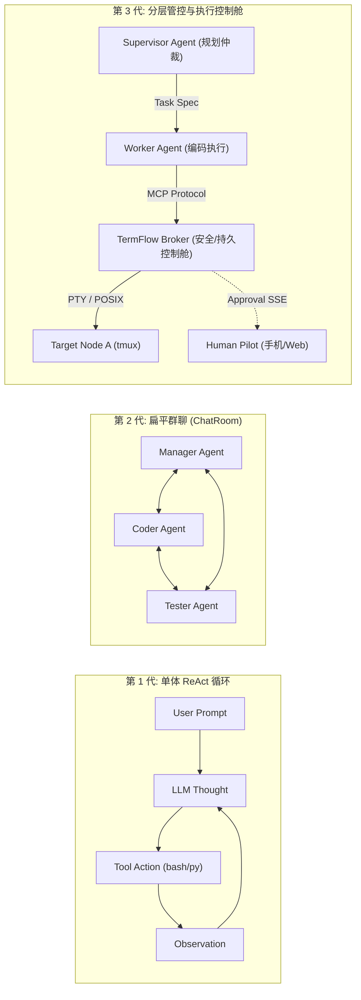
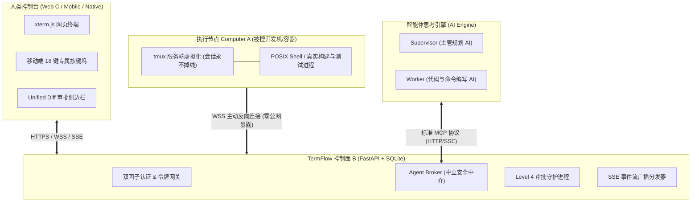
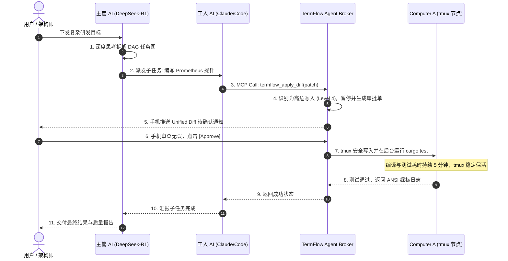

# 为什么 90% 的多智能体都在“演戏”？关于“AI 管理 AI 工作”的深度调研与 TermFlow 架构解密

> **标签**：`人工智能` `Multi-Agent` `TermFlow` `MCP协议` `tmux` `大模型系统架构` `Devin` `云原生`  
> **阅读时长**：约 15 分钟 | **适合读者**：AI 系统架构师、后端高工、云原生工程师、自主智能体开发者  


---

## 导语：从“聊天室灌水”到“真刀真枪接管操作系统”

最近一年，多智能体协同（Multi-Agent System）成了 AI 圈最火热的关键词。无论是 AutoGen、CrewAI 还是各种开源的 ChatDev 项目，Demo 视频里总是展现出极为美好的场景：
> *“只要输入一句话，产品经理 AI 就会写需求，架构师 AI 负责拆解任务，程序员 AI 噼里啪啦写代码，测试 AI 自动回归，五分钟交付一个商业级系统！”*

许多开发者在本地兴致勃勃地 `pip install` 之后，却迎头撞上冰冷的技术残酷现实：
1. **Agent 们在聊天室里你来我往、互相客套捧哏，Token 烧了几十万，代码却一行没落地；**
2. **好不容易开始执行命令，一个编译耗时 20 分钟，网络一抖动或者 HTTP 超时，后台子进程直接被操作系统暴毙砍死；**
3. **更可怕的是，某个负责重构的 Worker Agent 遇到报错，突然执行了类似 `rm -rf /` 或写死环境变量，把本地环境搞得一塌糊涂；**
4. **你想介入拉架？对不起，控制台只有满屏滚动的 JSON 日志，你连一个可以敲命令排障的 TTY 终端都找不到！**

**核心问题究竟出在哪？**
答案是：**“大模型解决的是认知编排（Cognitive Layer），而生产环境需要的是物理执行控制舱（Execution Cockpit）。”**

在这场“AI 管理 AI”的范式革命中，开源项目 **[TermFlow](https://github.com/mcocdaa/TermFlow)** 给出了一套令架构师击节赞叹的工业级答卷。

本文将为你深度调研当下“AI 管理 AI”的真实技术困局，并全方位拆解 TermFlow 是如何凭借 **“主动反向安全穿透 + 原生 tmux 虚拟化保活 + MCP Agent Broker + Level 4 指令审批护栏 + 移动端接管”**，成为多智能体分层管理不可或缺的基石。

---

## 一、 “AI 管理 AI”的架构代际演进

在讨论物理执行层之前，我们先梳理一下多智能体架构的发展脉络：



### 1.1 第一代：单体 ReAct 循环（2023 ~ 2024）
- 代表：早期的 AutoGPT、BabyAGI、LangChain Agents。
- 局限：单智能体“身兼数职”，随着任务步数增加，上下文窗口迅速被工具日志塞满，模型进入“注意力漂移”和死循环。

### 1.2 第二代：扁平多角色群聊（2024 ~ 2025）
- 代表：AutoGen GroupChat、CrewAI、ChatDev。
- 局限：角色虽分工（PM、Dev、QA），但所有人共享同一个上下文总线。各角色权限对等，缺乏严格的“主管-工人”主从监督约束，经常出现相互推诿与死循环客套。

### 1.3 第三代：分层管理与监督（Hierarchical Supervisor-Worker，2025 ~ 2026）
- 核心特征：
  - **主管 AI（Supervisor）**：采用最强推理大模型（如 DeepSeek-R1、Claude 3.7 Thinking），负责任务分解为有向无环图（DAG）、资源调度与产物验收；
  - **工人 AI（Worker）**：采用轻量级专用编码模型（如 DeepSeek-Coder、Claude Sonnet），负责单点任务的编写与调试；
  - **控制舱（Execution Cockpit）**：执行与认知的彻底解耦。

---

## 二、 工业落地的四大死穴：为什么单纯靠 Python 脚本玩不转？

当主管 AI 开始真正向工人 AI 下发指令时，会遇到四大物理级致命障碍：

### 2.1 物理死穴 1：执行黑盒与断网雪崩（Session Evaporation）
传统 Agent 工具调用通常使用 `subprocess.Popen` 或云厂商的无状态 HTTP Sandbox：
- 真实开发中的构建（如 `cargo build --release`、`npm run build`、内核模块编译）动辄需要 10 ~ 40 分钟。
- **一旦 LLM 服务商发生接口 30 秒超时、或者开发人员的网络稍有波动，HTTP 连接直接掐断，系统内核随即向该进程发送 SIGHUP 信号将其强行 Kill！**
- 结果：环境残留脏文件、包管理器被 lock 文件锁死、编译全部前功尽弃。

### 2.2 物理死穴 2：失控爆炸半径（Blast Radius Explosion）
- 工人 AI 在遭遇报错（例如某些权限不足、端口被占用或找不到文件）时，为了完成上级交代的任务，往往会产生极度危险的幻觉行为：
  ```bash
  chmod -R 777 /
  rm -rf /usr/local/*
  killall -9 python
  ```
- 如果直接把 Root 权限或普通 Shell 交给工人 AI，主机系统被“误伤”只需一秒钟。没有细粒度的**操作级语义拦截与审批**，任何无人值守都是灾难。

### 2.3 物理死穴 3：内网穿透与安全隔离（The Ingress Paradox）
- 现实业务中，主管 AI 往往运行在云端管理集群，而代码运行环境可能在：
  - 本地高性能开发机（RTX 4090 / Mac Studio）
  - 公司的内网测试机房
  - 隔离专有网络（VPC）中的 Docker 容器
- 如果为了让云端 AI 调度这些机器，强行开放 22 端口或 Docker Daemon 端口映射公网，无疑是在企业网络防护网开了一个致命后门。

### 2.4 物理死穴 4：人机在环（HITL）严重脱节
- 当主管 AI 与工人 AI 发现环境存在未解决的底层系统冲突（例如需要输入双因子认证 TOTP、或者需要人工裁决数据库迁移危险），当前的 Multi-Agent 系统往往只能把日志打在网页端，甚至直接抛出异常退出。
- 人类工程师无法即时、无缝地切入出事的那台机器的终端现场！

---

## 三、 破局利器：TermFlow 架构深度解密

针对以上顽疾，开源项目 **TermFlow** 提供了一个完美的架构参考。

TermFlow 将自己定义为：**面向人机共生的弹性跨端终端与智能体中继平台（Resilient Terminal & Agent Broker Platform）**。



### 3.1 核心杀手锏一：主动反向长连接（Reverse Outbound Tunnel）
在 TermFlow 的设计中，执行节点 **Computer A 从不监听任何公网入站端口**：
- Computer A 部署在任意内网、家庭宽带或 Docker 容器中；
- 启动时，Computer A 使用一次性注册凭据，**主动向 Control Plane B 建立加密 WebSocket/WSS 隧道**；
- 哪怕目标机处于三重 NAT 之后，只要它能访问公网 B，连接就瞬间打通！企业防火墙无需开放任何入站穿透，杜绝网络渗透风险。

### 3.2 核心杀手锏二：tmux 虚拟化与永不断线状态机
不同于直接调用系统底层进程，TermFlow 在 Computer A 端深度封装了 **tmux** 架构：
- **生命周期彻底解耦**：每个执行任务分配独立的 tmux Session 与 Window。任务是在操作系统内核中由 tmux 守护进程挂载执行的。
- **极度抗网络抖动**：即使主管 AI 发生网络闪断、甚至人类关闭了手机屏幕，后台的编译任务依然按照 POSIX 标准稳定运行。
- **随时无缝 Attach**：重新连接后，ANSI 全彩字符流和当前光标位置完美还原。

### 3.3 核心杀手锏三：内置 Agent Broker 与标准 MCP 原生对接
在 TermFlow v0.2.0 中，Control Plane B 正式集成了 **Agent Broker**：
- 对接 Anthropic 推出的全新开放标准 —— **Model Context Protocol (MCP)**；
- 主管 AI 和工人 AI 无需硬编码各种 Shell 封装，直接将 TermFlow 注册为标准 MCP Server；
- **固化工具白名单**：在 `opencode-config.yaml` 中实行极度严格的权限控制：
  ```yaml
  permission:
    "*": "deny"
    "termflow_*": "allow"
  ```
  工人 AI 原生自带的未受控底层破坏性工具全部失效，所有对操作系统的读取与写入，必须严格通过 TermFlow 的受控工具管道！

### 3.4 核心杀手锏四：Level 4 审批护栏与 Unified Diff 审查
为了彻底杜绝 Worker Agent 暴走，TermFlow 内置了四级分级防护与结构化审查：
- **只读操作（Level 1~2）**：如查看目录结构、查看文件内容、读取测试结果，自动高速放行；
- **高危写入（Level 4）**：当 Worker Agent 提议修改关键配置文件、执行大范围补丁覆盖时，Agent Broker **自动挂起该操作**，生成结构化的 Unified Diff，通过 SSE（Server-Sent Events）推送到人类前端；
- 只有在主管 AI 或人类工程师在界面上点击 `Approve` 之后，底层 tmux 才会真正落盘执行！

### 3.5 核心杀手锏五：专为手机打造的人机协同控制舱
很多时候，AI 运行在深夜或工程师在通勤途中。当 AI 主管报警或者需要确认时，TermFlow 提供了行业绝无仅有的移动端体验：
- **18 键触觉虚拟按键栏（MobileKeyBar）**：在手机屏幕上提供 `Esc`、`Ctrl`、`Alt`、`Tab`、方向键，自带振动反馈；
- **一键顶掉接管**：工程师拿出手机，浏览器点开即可秒连当前的 tmux pane，手动排查环境，然后一行指令切回交给 AI 继续跑。

---

## 四、 行业多维方案横向评测（Benchmark）

我们对业界现有的代表性方案进行了深入横向评测：

| 评估维度 | 原生 SSH / Docker Exec | 纯对话式 (AutoGen / CrewAI) | 商业级云沙盒 (Devin/OpenHands) | **TermFlow 执行控制舱** |
| :--- | :--- | :--- | :--- | :--- |
| **进程持久性** | ❌ 连接断开即 SIGHUP 杀死 | ❌ 依赖单次 HTTP，极脆弱 | ⚠️ 依赖云端实例，超期强杀 | **✅ 操作系统级 tmux，长任务永不掉线** |
| **网络穿透** | ❌ 必须开公网 22 端口 | ❌ 无法穿透企业 NAT 内网 | ⚠️ 源码必须全量上传云端 | **✅ 主动反向安全 WSS，零端口暴露** |
| **通信协议** | ❌ 私有 Shell 拼字符串 | ⚠️ 专有 JSON 消息通道 | ⚠️ 内部闭源通信协议 | **✅ 业界标准 MCP (Model Context Protocol)** |
| **安全控制** | ❌ 要么全给，要么全不给 | ❌ 仅粗暴文本确认 | ⚠️ 黑盒过滤，无法自定义 | **✅ Level 4 权限分级 + Unified Diff 审查** |
| **应急接管** | ⚠️ 需手动重新 SSH 找进程 | ❌ 无终端，只能在网页干瞪眼 | ⚠️ 网页交互延迟高，手机无法用 | **✅ 跨平台原生/移动端秒级接管，18键按键坞** |
| **部署成本** | 0（但极易出安全事故） | 纯库依赖（无底层控制力） | 极高（每月数百美元订阅） | **开源免费，轻量 Docker Compose 一键启动** |

---

## 五、 实战演练：三分钟搭建主管 AI 与 TermFlow 协作流水线

下面演示如何在你的本地或云服务器上，搭建一套完整的“主管 AI + 工人 AI + TermFlow”的自动化研发环境。

### 步骤 1：一键拉取 TermFlow 生产 Compose 镜像
```bash
TAG=v0.2.0
BASE="https://raw.githubusercontent.com/mcocdaa/TermFlow/${TAG}"
mkdir -p termflow-prod && cd termflow-prod

# 下载编排文件与配置
curl -fsSLO "${BASE}/deploy/compose.release.yaml"
curl -fsSLO "${BASE}/deploy/opencode-config.yaml"
curl -fsSLo .env "${BASE}/.env.example"
chmod 0600 .env

# 编辑 .env 配置你的 ADMIN TOKEN 与大模型 Key（支持 DeepSeek / Claude / Qwen）
vim .env

# 启动服务集群
docker compose --env-file .env -f compose.release.yaml up -d
```

启动完成后，访问 `http://127.0.0.1:8765` 即可看到 TermFlow 的现代化控制台！

### 步骤 2：启动受管节点 Computer A（Docker 节点）
在任意一台开发机上启动 Worker 计算容器，通过主动反向长连接注册到 B：
```bash
docker run -d \
  --name termflow-node \
  --restart unless-stopped \
  --network termflow_default \
  --cap-drop ALL \
  --cap-add SETUID \
  --cap-add SETGID \
  --security-opt no-new-privileges:true \
  --read-only \
  --tmpfs /tmp \
  --volume "$PWD/termflow-node-identity:/home/termflow" \
  --volume "$PWD/termflow-node-work:/work" \
  --env TERMFLOW_SERVER=http://control-plane:8000 \
  --env TERMFLOW_CODE='<你在 Web C 生成的注册码>' \
  termflow-node:v0.2.0
```

### 步骤 3：主管 AI 通过 MCP 协议驱动 Worker 节点
当主管 AI（Supervisor）接收到用户任务（例如：“为项目新增 Prometheus 指标监控并跑通单元测试”）时，全链路时序如下：



在整个过程中：
- **主管 AI 专心负责高维逻辑思考与质量验收；**
- **工人 AI 在严格沙箱和 MCP 协议约束下安全敲代码；**
- **TermFlow 全程守住底层的网络穿透、进程不掉线、以及高危命令的人类确认权！**

---

## 六、 总结与建议：如何把这个项目做大做爆？

“AI 管理 AI”不仅是一次上层大模型 Prompt 的升级，更是**底层操作系统运维基础设施的彻底重构**。

回顾软件工程历史：
- 当单机部署走向集群时，诞生了 **Kubernetes**；
- 当单体调用走向服务网格时，诞生了 **Istio**；
- **而今天，当软件开发从人类写代码走向“AI 管理 AI”时，我们必然需要一个介于大模型与操作系统之间的标准中介 —— 智能体执行控制舱（Agent Execution Cockpit）。**

作为国内少数率先实现 **tmux 虚拟化 + 反向 WSS 隧道 + 标准 MCP 协议 + 移动端自适应** 的开源项目，**TermFlow** 具备了成为下一代 AI 基础设施的全部潜质。

### 针对该项目的破圈与演进建议：
1. **抢占生态心智**：牢牢打响 **“MCP-Native 终端与智能体沙盒中继标准”** 这一标签。随着 MCP 成为事实上的全球智能体接口协议，TermFlow 的通用中介价值将指数级爆发；
2. **打爆高频刚需场景**：
   - “手机救火与多 Agent 协同”：在 B 站和小红书发布极客用手机接管 Agent 自动修 Bug 的短视频，打造科技美学视觉爆款；
   - “企业内网 Agent 接入方案”：帮助广大因合规要求不能开放 SSH 端口的企业，实现云端 AI 与本地 GPU 机房的安全协同；
3. **开源社区共建**：持续丰富对于多种大模型运行时（OpenCode、Claude Code、OpenHands）的无缝预设配置，降低开发者开箱即用门槛。

---
*欢迎 Star 并在本地亲自体验：[GitHub - TermFlow 官方仓库](https://github.com/mcocdaa/TermFlow)*  
*欢迎在评论区探讨：你认为 AI 管理 AI 的时代，人类工程师的核心生态位会迁移到哪里？*
